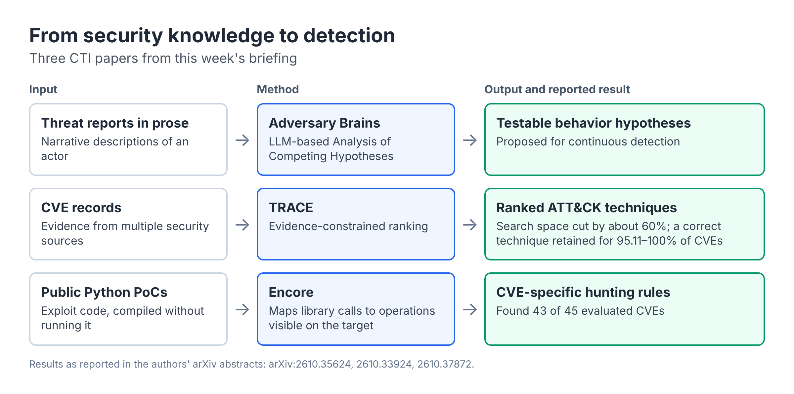

*Coverage: arXiv submissions from 23 to 29 October 2026 and related CISA advisories. Preprints have not necessarily been peer reviewed.*

## This week in brief

- **Agent forensics is emerging as a research theme.** AgentTrace identifies the model behind a black-box agent, while NovaFabric records agent runs as sealed evidence capsules.
- **Multi-agent attacks are moving towards the supply chain,** including MCP tool descriptions and compositions of individually clean agent skills. In CTI, three papers turn reports, CVEs and exploit code into detection or hypotheses about adversary behavior.
- **Evaluation practice is under scrutiny.** New work challenges results for both RAG poisoning defenses and industrial anomaly detection.

## New papers

### LLM and agent forensics

- [AgentTrace: Execution-Level Fingerprinting of Black-Box LLM Agents](https://doi.org/10.48550/arXiv.2610.32092). Gejian Zhao, Hanzhou Wu, Xinpeng Zhang. Uses ambiguous probes and Markov models of repair sequences to attribute the foundation model, reporting 96.0% accuracy under adversarial identity spoofing.
- [NovaFabric: A Black-Box Recorder for AI Agents with Sealed, Replayable, Diffable and Auditable Runs](https://doi.org/10.48550/arXiv.2610.34594). Mohsen Seyedkazemi Ardebili. An open-source technical report describing signed evidence capsules for agent runs. It presents no new experiments and refers to arXiv:2609.12582 for evaluation.
- [Tracing Money Laundering Across DeFi, Bridges, and Mixers on Ethereum](https://doi.org/10.48550/arXiv.2610.32210). Huan Xing, Gaohe Jin, Bang Fu, Yue Li, Baoning Niu, Xing Fan. FPTracer recovers intra-transaction asset flows and reports 98.6% recall for known laundering addresses across 20 real cases, plus 30 previously unreported bridge uses. It is included as a blockchain forensics automation example and is not described as LLM-based.

### Multi-agent system security

- [Judging Before Propagation: Task-Graph Contextual Integrity for Multi-Agent Privacy](https://doi.org/10.48550/arXiv.2610.39532). Hengyu Wu, Blaise Delattre, Yang Cao. Extends contextual integrity to workflow-level information flows, reducing mean unauthorized disclosures by 85.8–94.1% against a baseline while retaining 93.6–96.1% of its task accuracy.
- [Log-To-Leak: Prompt Injection Attacks on Tool-Using LLM Agents via the Model Context Protocol](https://doi.org/10.48550/arXiv.2610.36108). Yuepeng Hu, Chongyu Fan, Sirat Samyoun, Jian Du. Poisoned MCP tool metadata induces an additional attacker-controlled logging call, with 62.64–100% attack success across 18 model-server pairs.
- [Detecting Insecure Compositions of Clean Agent Skills via Capability-Flow Graph Analysis](https://doi.org/10.48550/arXiv.2610.32155). Yihao Li, Chuanpu Fu, Yizhou Zhao, Miao Chen, Qi Li, Ke Xu. KnotScryer analyzes 13,598 clean skills from ClawHub and identifies 612 insecure compositions.

### Cyber threat intelligence and attribution

- [Adversary Brains: Hypothesis-Based Logical Signatures for Threat Actor Detection with LLMs](https://doi.org/10.48550/arXiv.2610.35624). Gadi Evron. Proposes LLM-based models of threat actor behavior that scale Analysis of Competing Hypotheses to thousands of hypotheses for continuous detection.
- [CVE-to-ATT&CK Mapping via Evidence-Constrained Ranking](https://doi.org/10.48550/arXiv.2610.33924). Kai Wei, Yuwen Cui, Kehan Shen, Guangjing Wang. TRACE reduces the 201-technique search space by about 60% while retaining at least one correct technique for 95.11–100% of CVEs across six datasets.
- [Set an Exploit to Catch an Exploit: Compiling Public Proofs of Concept into Threat Hunting Rules](https://doi.org/10.48550/arXiv.2610.37872). Muhammad Shoaib, Alexander Suh, Joshua Andrew Tomiak, Wajih Ul Hassan. Encore compiles public Python exploits into hunting rules without running them and finds 43 of 45 evaluated CVEs.

### RAG security

- [GuardRAG: A Post-Retrieval Defense against Poisoning Attacks in Retrieval-Augmented Generation](https://doi.org/10.48550/arXiv.2610.35071). Linghui Jiao, Kang Wei, Fushuo Huo, Ruijie Zhao, Yiyang Ni, Jingcai Guo, Yipeng Zhou, Jun Li. A training-free defense that clusters retrieved documents and prunes suspicious groups, evaluated on three datasets and six LLMs.
- [Factual Yet One-Sided: Stance Poisoning and Evidence Balancing in Retrieval-Augmented Generation](https://doi.org/10.48550/arXiv.2610.34294). Puyuan Yang, Shaoxuan Dong, Liujie Wu, Xiaochun Cheng, Bo Li. Shows that factually correct but one-sided documents can shift RAG responses, and proposes a stance-balancing middleware.
- [Ranking Is Not Deciding: Benchmark Shortcuts and Operating-Point Collapse in Query-Time RAG Poisoning Defenses](https://doi.org/10.48550/arXiv.2610.33849). Pushkal Kumar, Arvin Sahaym. Removing one construction cue raises the miss rate of a re-implemented RAGuard from 0.191 to 0.763. Of 21 surveyed evaluations, 12 report no false-positive rate at the deployed operating point.

### Industrial anomaly detection

We found no paper this week that applies LLMs to SCADA anomaly detection, so this section covers a related evaluation study.

- [Adversarial Process Disturbances at a Deployable Alarm Budget: Detector Evaluation on a Simulator and a Real Plant](https://doi.org/10.48550/arXiv.2610.38786). Benjamin Blakely. Compares eleven detectors and finds that detection collapses on real plant telemetry, while sequential valve manipulation defeats the whole panel.

### Synthetic forensic and CPS data

- [AquaSense-ICS: A Hybrid Real-Simulated Cyber-Physical Dataset and Leakage-Aware Benchmark for Smart Water Quality Monitoring and Attack Detection](https://doi.org/10.48550/arXiv.2610.32661). Amal Neji, Mohamed Fourati, Lamia Chaari Fourati. Random splits yield a macro-F1 of 0.9998, but under a leakage-aware protocol no model beats the constant "normal" predictor for attack classification (macro-F1 0.465).

## ICS advisories from CISA

- [ICSA-26-300-01: EPICS Base](https://www.cisa.gov/news-events/ics-advisories/icsa-26-300-01). Released 27 October 2026. Covers CVE-2026-114595 to CVE-2026-114598 in release 7.0.10 and earlier, with a CVSS v3 score of 9.8.
- [ICSA-26-300-02: Mitsubishi Electric ICONICS products](https://www.cisa.gov/news-events/ics-advisories/icsa-26-300-02). Covers a product suite including GENESIS64 and Hyper Historian, with CVE-2026-16436 to CVE-2026-16438 and CVE-2023-4863.
- [ICSA-26-302-02: Hitachi Energy TRO600 series](https://www.cisa.gov/news-events/ics-advisories/icsa-26-302-02). Released 29 October 2026, with a CVSS v3 score of 7.5.
- [ICSA-26-302-03: Hitachi Energy CoreTec](https://www.cisa.gov/news-events/ics-advisories/icsa-26-302-03). An advisory for the CoreTec product.

## Trends

- **From LLMs as forensic tools to agents as subjects of investigation.** AgentTrace and NovaFabric address attribution and evidence for agent activity.
- **The agent ecosystem as an attack surface.** Tool metadata and skill compositions can create risk even when each component looks acceptable alone.
- **From reports to operational detection.** Adversary Brains, TRACE and Encore each turn security knowledge into something defenders can test or hunt with.
- **More demanding evaluation.** Several papers show strong headline results weakening under realistic data, thresholds or splits.

## Paper of the week

[AgentTrace](https://doi.org/10.48550/arXiv.2610.32092) stands out because it applies the attribution question to AI agents: which model is behind this activity? It relies on observable execution traces and remains effective under identity spoofing, according to its authors. That makes it a useful starting point for thinking about incidents that involve autonomous agents.

---

*Prepared with AI assistance. Paper details were checked against the arXiv abstract pages. Results are as reported by the authors.*

*Cover photo by [Tyler](https://unsplash.com/@tylergm) on [Unsplash](https://unsplash.com/photos/a-rack-of-electronic-equipment-in-a-dark-room-OnI_TNcIv9U). Figure created for this briefing.*
